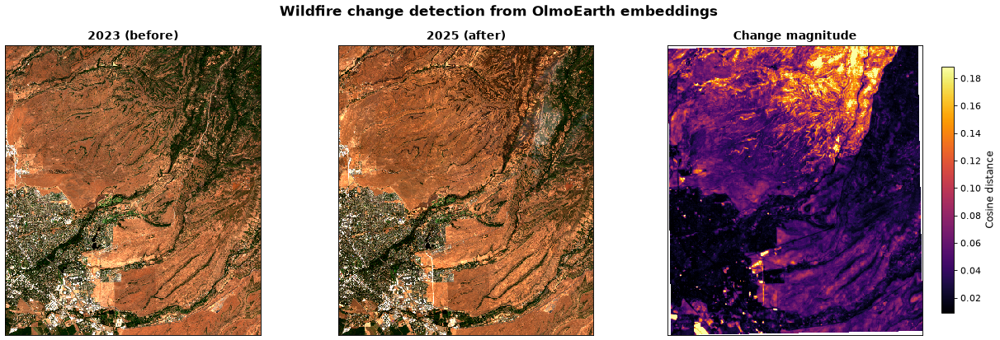
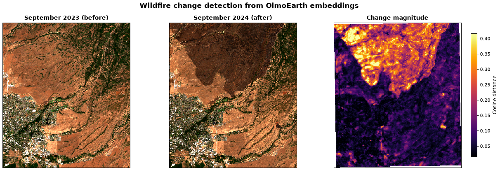

# Change Detection

Wildfire burn scar detection using per-pixel cosine distance between
annual OlmoEarth embeddings. Compares 2023 (before) and 2025 (after) over the
Park Fire region in Butte County, California. The fire burned from July to
September 2024, so comparing whole years on either side keeps pre- and
post-fire months out of the same composite, and annual composites avoid
seasonal artifacts.

## Usage

```bash
# 1. Download embeddings and imagery for both years
PYTHONPATH=src python -m olmoearth_embeddings_tutorial.change_detection.download

# 2. Analyze and generate figure
PYTHONPATH=src python -m olmoearth_embeddings_tutorial.change_detection.analyze \
    --before-dir data/change_detection/2023 \
    --after-dir data/change_detection/2025 \
    --out figures/
```

## Expected output

**Change detection** (`figures/change_detection.png`)

Left: Sentinel-2 RGB, September 2023. Center: Sentinel-2 RGB, September
2025. Right: cosine distance between the 2023 and 2025 embeddings (bright =
high change).



## Optional: custom monthly embeddings

Annual composites blur short events. By 2025 much of the burn scar had
greened up, so the annual comparison above shows weaker change in the
western part of the fire. With an OlmoEarth Studio API key, `custom.py`
computes one-month embeddings for September 2023 and September 2024 and
gives a sharper result:

```bash
export OLMOEARTH_API_KEY="your-key-here"
PYTHONPATH=src python -m olmoearth_embeddings_tutorial.change_detection.custom
PYTHONPATH=src python -m olmoearth_embeddings_tutorial.change_detection.analyze \
    --before-dir data/change_detection/custom/sept_2023 \
    --after-dir data/change_detection/custom/sept_2024 \
    --before-label "September 2023 (before)" \
    --after-label "September 2024 (after)" \
    --out figures/custom/
```


